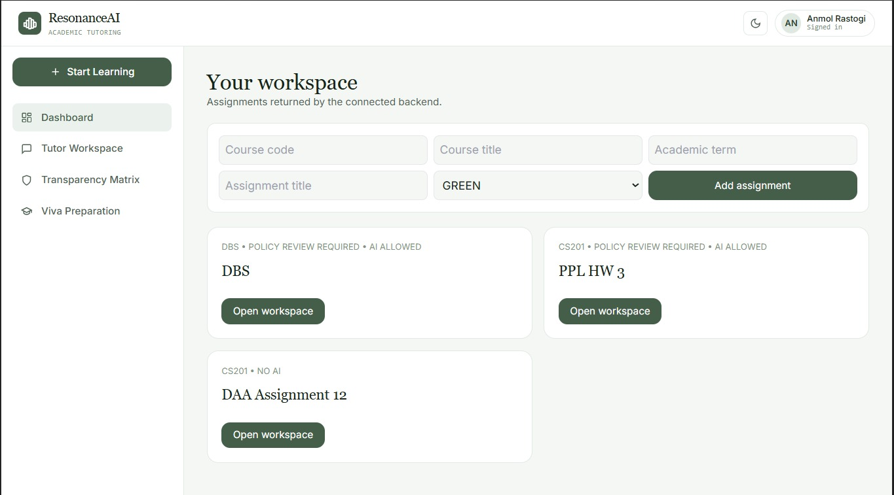
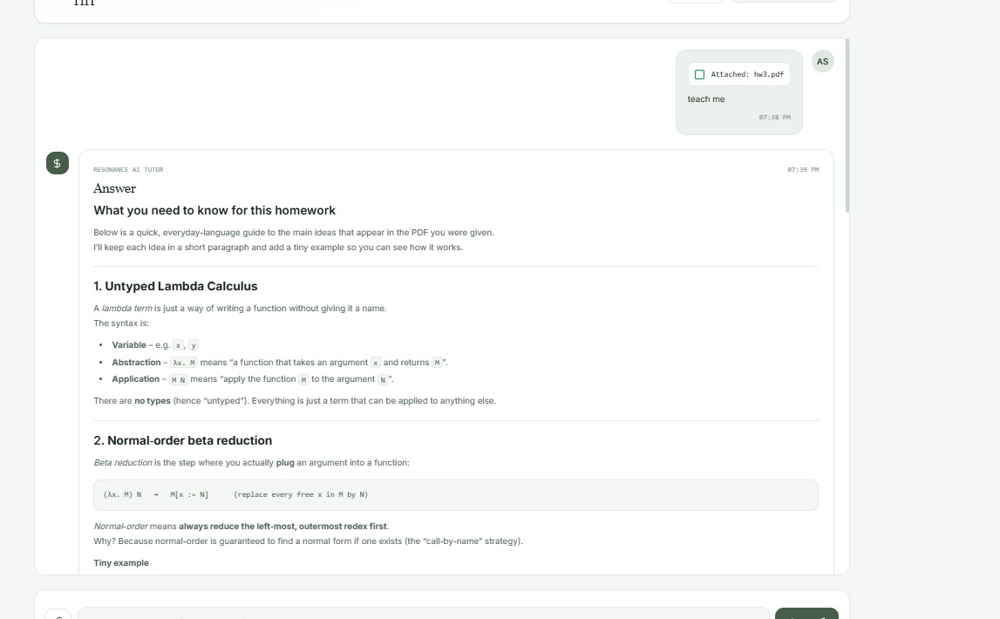
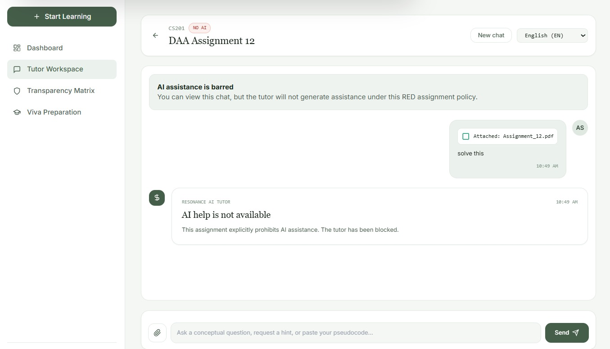
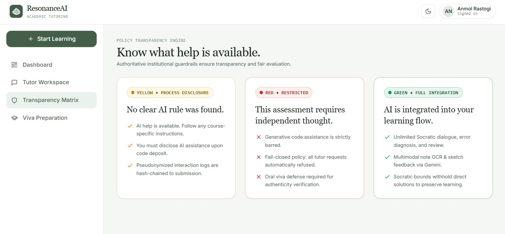
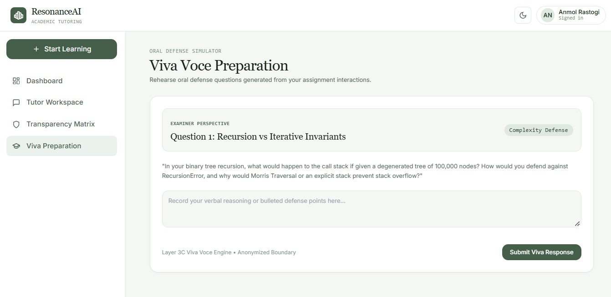

@'

---

# Application Screenshots & Results

## 1. Student Dashboard



## 2. AI Tutoring Interface



## 3. Assignment Policy Detection



## 4. Policy Classification Matrix



## 5. Viva / Assessment Interface



'@ | Add-Content -Path "README.md" -Encoding UTF8


# ResonanceAI backend

ResonanceAI includes preprocessing, tenant-scoped PostgreSQL accounts and assignments, and a policy-gated tutor workflow. The local Qwen adapter predicts intent/action labels; a configured Groq or Gemini provider generates the student-facing response.

## Run locally

Create a virtual environment, install `requirements.txt`, and copy `.env.example` to `.env`. For local migration, set `POSTGRES_MIGRATOR_DSN` to a PostgreSQL administrator connection (migration `0001` creates roles and enables `pgcrypto`). Keep `POSTGRES_DSN` set to the restricted `resonance_app` connection used by the running API. Also configure `AUTH_SIGNING_KEY` and `PROCESS_LOG_PSEUDONYM_KEY` (each at least 32 random bytes). Apply schema migrations before launching:

```powershell
python scripts/bootstrap_data_layer.py
```

Set `GEMINI_API_KEY` to enable real Gemini preprocessing. Then run:

```powershell
python -m uvicorn app.main:app --reload
```

Open http://localhost:8000/app. Create an account with an institution ID (letters, numbers, underscores, or hyphens). Other users in that institution can register using the same ID and exact institution name. Sign-in requires the institution ID, email, and password. Once signed in, add assignments from the dashboard; they are stored for that institution and loaded on later sign-ins.

Generate local secrets with `python -c "import secrets; print(secrets.token_urlsafe(48))"`. Registration is open and creates an institution when its ID is new; this is intended for local integration testing, without email verification or institution administrator approval. Protect the service from public access until an institutional onboarding and administrator workflow is added. Session tokens expire after `SESSION_TTL_SECONDS` and are stored in the browser's local storage; signing out removes the browser token.

Run the deterministic test suite with:

```powershell
python -m pytest -q
```

## Local tutoring pipeline placeholder

The fine-tuned model can be unavailable while the request workflow is being
integrated. For a deterministic, offline end-to-end run, set
`LOCAL_PLACEHOLDER_ENABLED=true` in `.env` and start the app as usual. This
mounts `POST /dev/tutor/chat`, backed by local adapters that implement the same
ports used by the orchestrator. The route uses server-owned demo assignments:
`demo-green`, `demo-yellow`, and `demo-red`; policy is never accepted from the
request. Its demo identity and audit records are in-memory development
fixtures, not production authentication or durable storage. Leave the flag off
outside local development.

Example request:

```json
{
  "request_id": "local-1",
  "assignment_id": "demo-green",
  "message": "Explain recursion"
}
```

The optional Qwen inference client predicts intent/action labels. The backend
validates those labels through `PolicyActionService`; the configured Groq or
Gemini provider generates the response text. GREEN allows a full explanation,
YELLOW asks for Socratic guidance after disclosure, and RED is refused before
any model call. Set `GROQ_API_KEY` or `GEMINI_API_KEY` to enable response
generation; `/ready` reports `tutor_response_generation`.

To use the separately hosted Qwen classifier with the optional demo route, set
`MODEL_INFERENCE_URL` to the private inference server's complete `/predict`
URL, `MODEL_INFERENCE_API_KEY` to its API key, and optionally
`MODEL_INFERENCE_TIMEOUT` (default `120`). When either endpoint setting is
present, the route selects the real inference client; incomplete configuration
and provider failures return an error and never fall back to placeholder
predictions. Requests send normalized student text, assignment context, and
the policy level resolved by the backend. Model recommendations still pass
through `PolicyActionService` before response generation.

Gemini is required for translation, image extraction, and candidate policy evidence extraction. The process can start without a Gemini or Groq key; `/ready` reports whether response generation is configured. No live provider calls are made by the standard test suite.

## Current routes

- `GET /` and `GET /health`: process liveness.
- `GET /ready`: process readiness and provider, assignment-store, authentication, and Qwen configuration state. It does not probe provider connectivity.
- `POST /api/auth/register`, `POST /api/auth/login`, and `GET /api/auth/me`: institution-scoped registration and bearer sessions. Registration creates an institution when the supplied ID is unused.
- `GET /api/assignments` and `POST /api/assignments`: authenticated, institution-scoped assignment listing and creation.
- `POST /api/tutor/chat`: authenticated tutoring on an assignment belonging to the signed-in user's institution; policy is resolved from PostgreSQL.
- `POST /preprocess`: multipart text and PNG/JPEG/WebP input. Returns original and normalized text, language and extraction statuses, provenance, warnings, and policy resolution metadata. Uploads are processed in memory and not persisted.
- `POST /dev/tutor/chat`: demo assignment route, mounted only when `LOCAL_PLACEHOLDER_ENABLED=true`.

The router accepts an authoritative policy lookup callback for embedding applications. The standalone app has no such repository, so a missing or unresolved policy uses `YELLOW` guided assistance (`POLICY_NOT_FOUND`, `ASSIGNMENT_NOT_FOUND`, or the relevant conflict reason). A repository callback can distinguish a missing assignment (`ASSIGNMENT_NOT_FOUND`, return `None`) from a known assignment with no policy (empty list). RED remains blocked. YELLOW requires the `disclosure_acknowledged=true` multipart field and returns its configured conditions if acknowledgment is missing. This is a request-level acknowledgment only; no durable acknowledgment record or authenticated user identity exists. Candidate Gemini evidence remains non-authoritative. Stored policy outranks extracted text. Conflicting settings, differing conditions or versions, and unsupported policy scopes use YELLOW and retain their review reason.

## Policy and tutoring boundary

The existing wire values are retained: `NO_AI` → `RED`, `PROCESS_DISCLOSURE` → `YELLOW`, `FULL_INTEGRATION` → `GREEN`. Missing, ambiguous, invalid, or conflicting policy does not become `GREEN`. The authenticated tutor route loads the assignment and current policy in the caller's tenant scope before model inference. Do not expose `MultilingualGuidanceService` directly to untrusted clients.

The current `MultilingualGuidanceService` remains an internal streaming provider orchestrator. The authenticated non-streaming tutor route uses the same Groq/Gemini adapters for response generation after Qwen classification and deterministic policy selection.

## Preprocessing and future classifier

The configured Gemini REST adapter requests structured JSON. Translation retains the student's source text; OCR/document content is returned separately with provenance. Unreadable images produce a partial result and warning. Provider configuration, authentication, throttling, timeout, malformed-response, and outage failures are mapped to safe API errors. Text and image limits come from `PREPROCESS_MAX_*` settings.

The Qwen inference adapter validates the trained model's intent/action output. Its recommendation remains advisory; the Python policy/action layer decides what generation is allowed before any response provider call.

Open registration is intended for local integration testing and has no email verification or institution administrator approval. Session tokens are bearer tokens stored in browser local storage. Do not expose this build to public users until institutional onboarding and administrator authorization are implemented. Selectable-text PDF extraction is not part of this snapshot.
