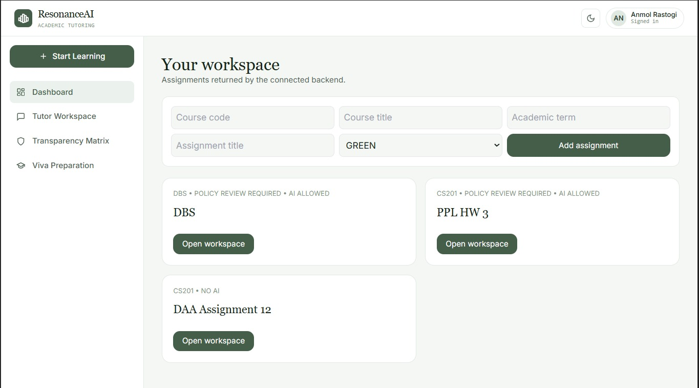
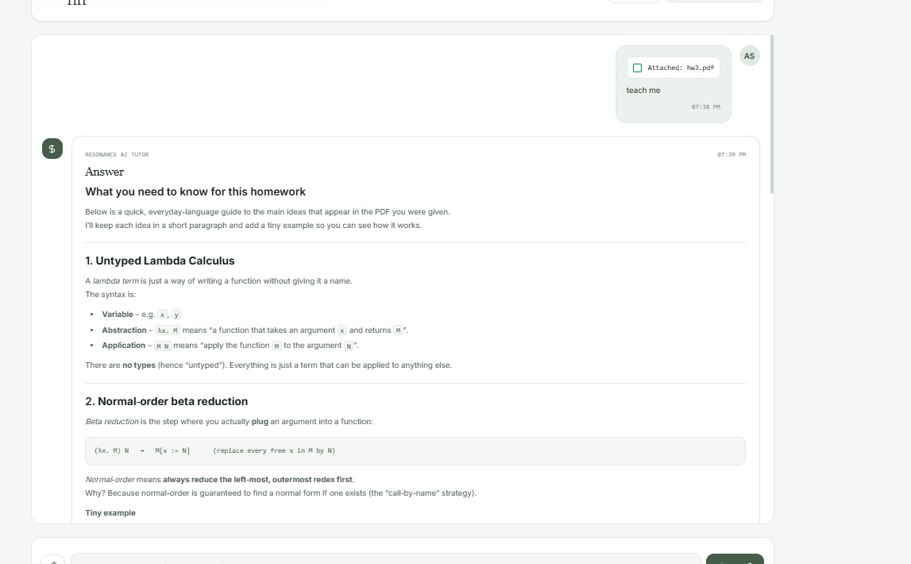
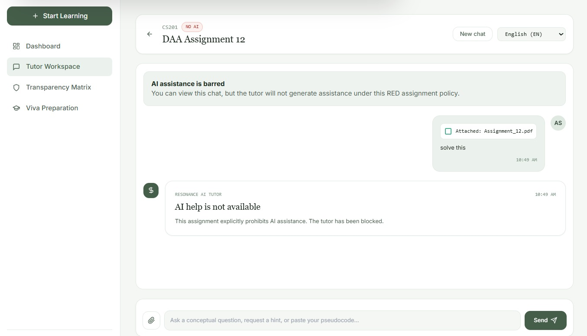
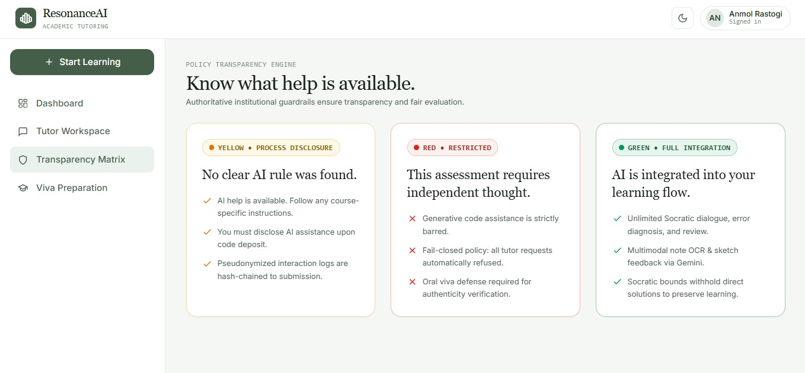
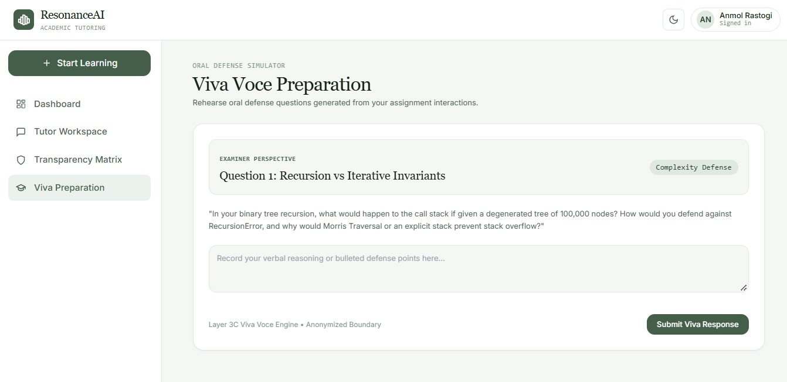

# ResonanceAI — Project Results

This page showcases the implemented ResonanceAI application and its key features.

## 1. Student Dashboard

The main dashboard through which students access the platform.

## 2. AI Tutoring Interface

The student-facing conversational interface for AI-powered academic assistance.

## 3. Assignment Policy Detection

Demonstration of assignment policy detection and policy-aware response handling.

## 4. Policy Classification Matrix

Overview of the policy classification and decision matrix.

## 5. Viva / Assessment Interface

Demonstration of the viva-related functionality.

